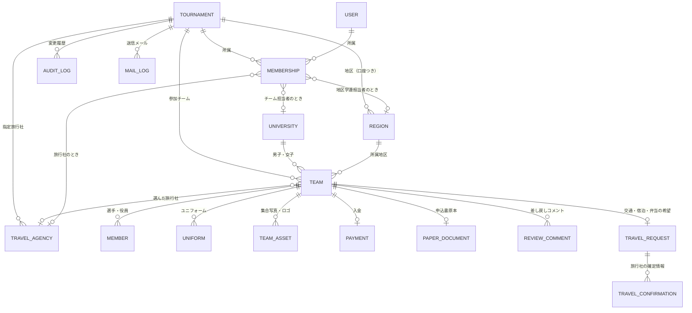

# データ設計（ER図）

- 版：第1版（承認待ち）
- 作成日：2026年11月15日

---

## 1. 考え方

- **「大会」ごとにデータを分けます。** 令和9年度大会・令和10年度大会…がそれぞれ1件の「大会」で、チーム・名簿・入金などはすべてどれかの大会に属します。来年度は「前年度の大会を複製」して、金額・日程・地区・口座・旅行社の設定を引き継ぎます（名簿などの個人情報は複製しません）。
- **大学は毎年使い回します。** 大学名や担当者は年度をまたいで残り、チーム（男子／女子）は大会ごとに作ります。
- **金額・人数の上限・日程・画像条件は「大会の設定」に持たせます。** 管理画面から変更でき、プログラムは触りません。
- **誰が何を見られるかは「所属」で決めます。** 1人のユーザーが「令和9年度大会の〇〇大学のチーム担当者」「令和9年度大会の東北地区の地区学連担当者」のような所属を持ち、データベースがこれを見て閲覧を制限します。

## 2. ER図（データのつながり）

## 3. 各データの項目

### 大会（TOURNAMENT）
| 項目 | 内容 |
|---|---|
| 名称・年度 | 例：第〇回全日本学生ハンドボール選手権大会（令和9年度） |
| 状態 | 準備中／受付中／締切後／大会終了／アーカイブ |
| 日程 | 申込締切、写真締切、振込締切、旅行社の申込締切、組み合わせ抽選日、大会期間、保険期間（開始日・日数） |
| 金額 | 参加料（75,000円）、保険料（500円）、協賛ユニフォーム料（10,000円） |
| 人数の上限 | 役員6・選手25・ベンチ役員5・ベンチ選手16・留学生エントリー3・留学生ゲームエントリー2・背番号1〜99 |
| 画像条件 | 顔写真・集合写真・ロゴそれぞれの形式・最小サイズ・縦横比・容量 |
| 運用の切替 | 紙原本の扱い（郵送／PDFアップロード）、事務局の再確認の有無、リマインドを送る日（7日前・前日） |
| 個人情報の削除日 | 写真の削除日、名簿の削除日（全日本学連の規定に合わせて設定） |

### 地区（REGION）
地区名、表示順、**振込口座**（銀行・支店・種別・番号・名義）、連絡先。

### 大学（UNIVERSITY）※年度をまたいで使う
大学名、ふりがな、振込名義用のカナ表記。

### チーム（TEAM）
| 項目 | 内容 |
|---|---|
| 大学・男女・地区 | 大学1つにつき男子・女子が最大1チームずつ |
| 状態 | 未着手／入力中／提出済／地区承認済／事務局確認済／差し戻し |
| ロック | 締切後は自動でロック。事務局が解除した場合は「いつまで・誰が・理由」を記録 |
| 連絡先 | 担当者名・電話・メール |
| 登録確認 | JHA登録番号・全日本学連登録番号、事務局確認済の印 |
| 引率責任者 | 氏名・職名、専任教職員または部長任命者であることの確認、役員名簿の誰か（未登録ならベンチ不可の注意） |
| 選んだ旅行社 | 3社程度から1社 |
| パンフ用 | チーム名の表記、ひとこと紹介（文字数制限あり） |

### 選手・役員（MEMBER）
| 項目 | 選手 | 役員 |
|---|---|---|
| 区分 | 選手 | 役員（役職：部長・監督・コーチ・トレーナー・マネージャー等） |
| 氏名・ふりがな | ○ | ○ |
| 生年月日（未成年の自動判定・保険用） | ○ | ○ |
| 背番号（1〜99・チーム内で重複不可） | エントリー選手のみ | － |
| エントリー（25名）／氏名のみ掲載 | ○ | － |
| ベンチ登録 | ○ | ○ |
| 学年・学部・ポジション・出身高校・身長・体重・利き手 | エントリー選手のみ | － |
| 学生かどうか（学生役員は保険加入必須） | （全員学生） | ○ |
| 留学生の区分（なし／留学生／短期留学生） | ○ | － |
| 保険加入 | 自動で加入 | 学生役員は自動、それ以外は任意 |
| 顔写真・掲載への同意 | ○ | ○ |
| ドーピング同意書の携帯確認（未成年のみ） | ○ | － |

### ユニフォーム（UNIFORM）
用途（CP用／GK用）、色の名前、濃色／淡色、協賛企業名入りの有無。
→ 「CP用・GK用それぞれ濃色と淡色が1着以上」になっているかを自動でチェック。

### チームの画像（TEAM_ASSET）
種類（集合写真／ロゴ）、ファイル、検査結果。

### 入金（PAYMENT）
請求額（自動計算：参加料＋保険料×加入人数）、振込額、振込日、振込名義、振込控えのファイル、状態（未入金／確認中／入金確認済）、確認した地区学連担当者と日時。協賛ユニフォーム料（現地現金払い）は別欄で管理。

### 申込書原本（PAPER_DOCUMENT）
方式（紙郵送／PDFアップロード）、状態（未送付／郵送済／到着確認 または 未提出／提出済／確認済）、押印済みPDF、確認者と日時。

### 差し戻しコメント（REVIEW_COMMENT）
誰が（地区学連／事務局）、いつ、どの項目について、コメント本文、対応済みかどうか。

### 指定旅行社（TRAVEL_AGENCY）
社名、担当者、連絡先、受付締切、表示順。

### 交通・宿泊・弁当の希望（TRAVEL_REQUEST）／確定情報（TRAVEL_CONFIRMATION）
希望の入力項目は旅行社にヒアリングしてから確定するため、**項目を後から追加・変更できる形**で保存します。確定情報は旅行社が入力し（部屋割り・金額・変更点・添付ファイル）、変更のたびに新しい版として履歴を残します。

### ユーザー（USER）と所属（MEMBERSHIP）
| 項目 | 内容 |
|---|---|
| ユーザー | メールアドレス、氏名（ログインは招待メールから） |
| 所属 | 大会、ロール（チーム担当者／地区学連担当者／事務局／旅行社）、対象（どの大学・どの地区・どの旅行社か） |

### 変更履歴（AUDIT_LOG）／送信メール（MAIL_LOG）
変更履歴：いつ・誰が・どのデータの・どの項目を・何から何に変えたか（データベースが自動で記録）。
送信メール：いつ・誰に・どの種類のメールを送ったか。

## 4. 見られる範囲（権限）

| データ | チーム担当者 | 地区学連 | 事務局 | 旅行社 |
|---|---|---|---|---|
| 大会の設定 | 閲覧 | 閲覧 | 変更 | 閲覧（日程のみ） |
| 自大学のチーム・名簿・写真 | 変更（ロック前） | 自地区のみ閲覧・承認・差し戻し | すべて | － |
| 入金 | 自チームの控えをアップロード | 自地区の照合・状態変更 | すべて | － |
| 申込書原本 | 自チームの提出 | 自地区の到着確認 | すべて | － |
| 交通・宿泊・弁当 | 自チーム分を入力・確定情報を閲覧 | 自地区を閲覧 | すべて | **自社を選んだチームのみ**閲覧・確定情報を入力 |
| 旅行社が見られる名簿の項目 | － | － | － | 氏名・男女・区分（選手/役員）のみ。写真・生年月日・出身高校などは見えない |
| 変更履歴 | － | － | 閲覧 | － |
