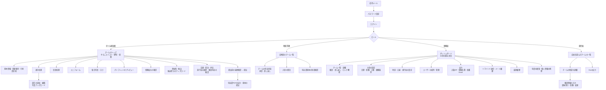

# 画面一覧・画面遷移図

- 版：第1版（承認待ち）
- 作成日：2026年11月15日

---

## 1. 画面遷移図

## 2. 画面一覧

### 共通
| 番号 | 画面 | 内容 |
|---|---|---|
| C-1 | ログイン | メールアドレスとパスワード。パスワードを忘れたときの再設定 |
| C-2 | パスワード設定 | 招待メールのリンクから開く |
| C-3 | 大会の切り替え | 複数年度に所属している場合のみ |

### チーム担当者（スマホでも使いやすい画面）
| 番号 | 画面 | 内容 |
|---|---|---|
| T-0 | チームのトップ | 男子／女子の切り替え。「あと何をすればよいか」のやることリスト、締切までの残り日数、差し戻しコメント |
| T-1 | 基本情報 | 連絡先、JHA・全日本学連の登録番号、引率責任者 |
| T-2 | 選手名簿 | 一覧（背番号順）。エントリー25名／氏名のみの部員を分けて表示。人数・留学生数・背番号の重複をその場で表示 |
| T-2a | 選手の追加・編集 | 1人ずつ入力。写真はスマホのカメラ・アルバムから選べ、その場で条件を検査して理由を表示 |
| T-3 | 役員名簿 | 役職・氏名・写真・学生かどうか・保険の任意加入 |
| T-4 | ユニフォーム | CP用・GK用の色、濃色/淡色、協賛企業名入り |
| T-5 | 集合写真・ロゴ | アップロードと検査 |
| T-6 | パンフレットのプレビュー | 掲載イメージ。文字数オーバー・写真の不足を赤く表示 |
| T-7 | 保険加入の確認 | 加入者の一覧と保険料 |
| T-8 | 参加料・振込 | 請求額の内訳、振込先口座（所属地区の口座）、振込名義のルール、振込控えのアップロード、入金の状態 |
| T-9 | 交通・宿泊・弁当 | 旅行社を1社選ぶ → 希望を入力 → 旅行社からの確定内容を確認 |
| T-10 | 最終確認・提出 | 入力漏れ・ルール違反があれば一覧で表示し、すべて解消すると「提出」できる |
| T-11 | 申込書の出力・原本 | 角印欄つきPDFの出力、郵送状況の入力 または 押印済みPDFのアップロード |

### 地区学連
| 番号 | 画面 | 内容 |
|---|---|---|
| R-0 | 自地区のチーム一覧 | 状態・入金・原本・写真の不備が一目でわかる表 |
| R-1 | チームの申込内容 | 全項目の確認、承認、差し戻し（項目ごとにコメント） |
| R-2 | 入金の照合 | 請求額と振込額、振込控えの画像、状態の更新、過不足の警告 |
| R-3 | 原本の到着確認 | 到着の記録 |

### 事務局
| 番号 | 画面 | 内容 |
|---|---|---|
| A-0 | ダッシュボード | 男女64枠の進み具合、未入金、原本未着、写真不備、旅行社未選択の件数 |
| A-1 | チーム一覧・詳細 | 全チームの確認・差し戻し、登録番号の確認済の印、ロックの解除 |
| A-2 | 大会の設定 | 日程・金額・上限・画像条件・運用の切替・個人情報の削除日 |
| A-3 | 地区・口座・旅行社 | 地区ごとの口座、旅行社の登録 |
| A-4 | ユーザーの招待・管理 | 大学・地区学連・旅行社の担当者を招待、停止 |
| A-5 | 出力 | 印刷会社入稿ZIP（Excel名簿＋画像）、保険会社向け名簿、チーム一覧Excel |
| A-6 | メール | 締切リマインドの一斉送信、送信履歴 |
| A-7 | 変更履歴 | 誰が・いつ・何を変えたかの検索 |
| A-8 | 年度の管理 | 前年度大会の複製、写真・名簿の削除の実行 |

### 旅行社
| 番号 | 画面 | 内容 |
|---|---|---|
| V-0 | チーム一覧 | 自社を選んだチームのみ。希望の入力状況 |
| V-1 | 希望の詳細 | 宿泊・弁当・交通の希望 |
| V-2 | 確定情報の入力 | 部屋割り・金額・変更点・添付ファイル。保存するとチームにメール |
| V-3 | Excel出力 | 自社分の一覧 |
