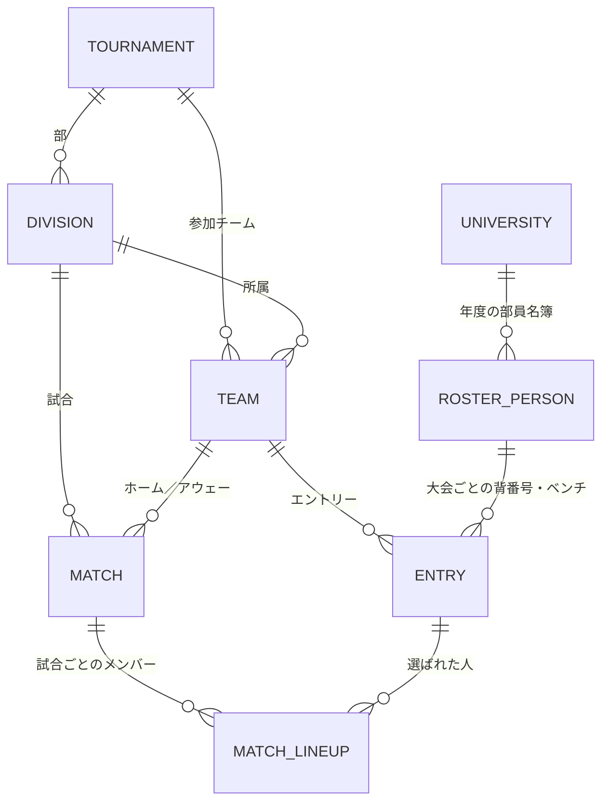

# リーグ戦対応 要件と設計（東北学生リーグ）

- 版：第2版（承認待ち）
- 作成日：2026年11月23日（第2版：試合記録・個人成績を追加）
- 位置づけ：要件定義書（docs/01）・データ設計（docs/03）への追加

---

## 1. 目的

全日本学生選手権のために作った申込システムを、**東北学生リーグ（春季・秋季）**でも使えるようにします。

- 東北の大学は、**年度の部員名簿を1回入力するだけ**で、春季リーグ・秋季リーグ・全日本学生選手権に申し込めるようにする。
- 東北学連は、リーグの申込・入金・日程・結果・順位表を1か所で管理する。
- 日程・結果・順位表は、選手・保護者・OBがスマホで見られる**公開ページ**に出す。
- **2027年春季リーグを、全日本の本番前の試験運用にする。**

## 2. ヒアリングで決まったこと

| 項目 | 決定内容 |
|---|---|
| システムに任せること | 参加申込と選手登録／参加費・入金の管理／試合日程・結果・順位表／試合ごとのメンバー提出 |
| リーグの形 | 春季・秋季の年2回、男子・女子、部制あり（例：男子1部・2部、女子） |
| 名簿 | **年度の部員名簿を大学ごとに共通化**し、各大会ではそこからエントリーを選ぶ。背番号は大会ごとに決められる |
| 春季リーグの日程（2027年） | **4月上旬に申込締切、5月開幕** |
| 試合結果の入力 | **東北学連の役員**がスマホで入力 |
| 公開ページ | **公開する**（日程・スコア・順位表のみ。名簿などの個人情報は出さない） |
| 順位の決め方 | **勝ち2点・引き分け1点・負け0点**。同点の場合の順序（当該チーム間の成績、得失点差など）は要項を確認して確定 |
| 公式記録 | 今は紙に手書き。**iPadで記録員が入力しやすい画面**を作り、その内容が**公式記録用紙（JHA様式）**に反映されるようにする |
| 個人記録 | 公式記録（得点・罰則）から**個人成績表**を自動で作る。公式記録にない**CPのシュート数・得点数、GKの被シュート数・セーブ数**も記録する |
| シュート・セーブの記録 | **学連の記録員が試合中に記録** |
| 個人成績の公開 | **すべて公開**（得点・罰則・シュート率・セーブ率） |
| 使い始める時期 | 公式記録（得点・罰則）と個人成績表は**春季リーグの開幕から**、シュート・セーブの記録は**秋季リーグから** |

## 3. 全日本とリーグの違い（設定で切り替える）

| 項目 | 全日本学生選手権 | 東北学生リーグ |
|---|---|---|
| 主催 | 全日本学連（事務局） | 東北学連 |
| 参加できる大学 | 全国（8地区） | 東北の大学のみ |
| 承認の流れ | チーム → 地区学連が承認 → 事務局が確認 | チーム → **東北学連が承認**（1段階） |
| 部 | なし（男子・女子） | **男子1部・2部、女子**など |
| 人数の上限・参加料 | 要項の値 | リーグの要項の値（部ごとに参加料を変えられる） |
| 試合日程・結果・順位 | 対象外 | **あり** |
| 試合ごとのメンバー提出 | 対象外（必要になれば追加） | **あり** |
| パンフレット・保険・旅行社 | あり | 使わない（設定でオフ） |

金額・人数の上限・締切・使う機能は、すべて**大会ごとの設定**で切り替えます。プログラムを大会ごとに作り分けることはしません。

## 4. 機能要件（追加分）

### L-1. 年度の部員名簿（全大会で共通）
- 大学ごと・男女ごとに「**令和9年度の部員名簿**」を持つ。氏名・ふりがな・生年月日・学年・学部・出身高校・身長体重・利き手・ポジション・留学生区分・顔写真・掲載同意など、**人に関する情報はここに1回だけ入力**する。
- 各大会の申込では、部員名簿から**エントリーする人を選び、その大会の背番号とベンチ登録を決める**。
- 学年の進行や退部は、年度の名簿で管理する。新年度の名簿は、前年度の名簿から引き継いで作れる（学年は自動で1つ上げる）。
- 背番号は大会ごとに別に決められる。大会の中では重複できない。

### L-2. リーグの参加申込
- 東北学連が、春季・秋季のリーグを「大会」として作成し、部（男子1部・2部、女子など）と、どの大学がどの部に属するかを登録する。
- 参加申込の画面・チェック・提出・差し戻しは、全日本と同じ仕組みを使う。承認は東北学連の1段階。
- 参加費は部ごとに設定できる。入金管理は M3 で作る仕組みを共通で使う。

### L-3. 試合日程
- 東北学連が、部ごとに試合（日時・会場・対戦カード・節）を登録する。総当たりの対戦カードの自動作成と、Excel からの一括取り込みを用意する。
- 日程の変更（延期・会場変更）を記録し、公開ページに反映する。

### L-4. 試合ごとのメンバー提出
- 各チームは、試合ごとにベンチに入るメンバー（選手・役員の上限はリーグの設定値）を、エントリー済みの人から選んで提出する。
- 提出の締切（例：試合の前日20時）を設定できる。締切後の変更は東北学連のみ。
- 提出されたメンバー表は、試合ごとに印刷・PDF保存できる（記録用紙への転記用）。

### L-5. 試合結果の入力
- 東北学連の役員が、会場でスマホから入力する（前後半の得点、最終スコア、没収試合などの特記）。
- 入力した結果は、**確定ボタンを押すまで公開しない**。確定後の修正は、修正履歴が残る。

### L-6. 順位表
- 部ごとに、勝ち2点・引き分け1点・負け0点で自動計算する（試合数・勝・分・敗・勝ち点・得点・失点・得失点差）。
- 同点の場合の順序は、要項に合わせて設定する（例：当該チーム間の勝ち点 → 当該チーム間の得失点差 → 全体の得失点差 → 総得点）。

### L-7. 公開ページ
- ログインなしで見られる。表示するのは**大会名・部・日程・会場・スコア・順位表だけ**。
- 名簿・写真・連絡先などは一切出さない（データベース側で、公開用の項目しか読めないようにする）。
- スマホで見やすく、URL を SNS や学連のホームページで共有できる。

### L-8. iPadの記録用画面（公式記録の入力）
- 記録員が、試合中にiPad（横向き）で入力する。大きなボタンで、片手でも押し間違えにくい配置にする。
- 試合前：両チームの「試合ごとのメンバー」（L-4）が自動で読み込まれ、背番号・氏名・役員が並ぶ。当日の変更（追加・欠場）もここで直せる。
- 試合中に記録するもの（JHA公式記録用紙の項目に合わせる。項目は様式を受け取ってから確定）：
  - 得点（時間・チーム・背番号、7mスローによる得点かどうか）
  - 7mスローの失敗
  - 警告（イエローカード）・2分間退場・失格（レッドカード）・報告書つき失格（ブルーカード）（時間・背番号または役員）
  - チームタイムアウト（時間）
  - 前半・後半のスコア（自動で集計）、延長・7mコンテストがある場合はその結果
- 時間は、記録員が試合時計に合わせて動かす画面上の時計から自動で入る（手入力で直せる）。
- **取り消し・修正**がすぐできる（直前の操作の取り消し、記録の一覧から修正）。修正は履歴に残る。
- **会場の電波が弱くても止まらない**：記録はまずiPadの中に保存し、電波が戻ったら自動で送る。送れていない記録があるときは画面に表示する。
- 試合終了後、記録員と審判（または立会人）が内容を確認して「確定」すると、結果・順位表・個人成績に反映され、公開ページに出る。

### L-9. 公式記録用紙の出力
- 入力した記録から、**JHAの公式記録用紙と同じ配置**の用紙をPDF・印刷で出力する（チーム欄・得点経過・罰則・前後半スコアなど）。
- 試合前に、チーム欄（背番号・氏名・役員）だけを印字した用紙も出せる（紙で記録する会場や、予備用）。
- **JHAの公式記録用紙の様式（空欄のもの、PDFや写真）と、記入例をいただいてから、配置を合わせる。**

### L-10. 個人成績表
- 大会（リーグ）を通した個人成績を自動で集計する：出場試合数、得点、7mスロー得点、警告・2分間退場・失格の回数。
- 秋季からは、シュート数・シュート成功率（CP）、被シュート数・セーブ数・セーブ率（GK）も集計する。
- 得点ランキング、GKのセーブ率ランキング（一定の出場条件を満たした人）を表示する。
- **公開ページにすべて公開する**（氏名・大学・背番号・成績）。名簿の他の項目（生年月日・出身高校・写真など）は出さない。

### L-11. シュート・セーブの記録（秋季から）
- 記録員が、L-8 と同じ画面で、シュート（得点・セーブされた・枠外/ブロック）と、そのときの相手GKを記録する。
- 得点の記録と一緒に入力するので、公式記録との食い違いが起きない。

### 個人情報の取り扱い（追加の注意）
- 個人成績を氏名つきで公開するため、選手登録の画面に「**試合記録（氏名・大学・背番号・得点などの成績）を公開ページで公開します**」と明示し、登録時に確認してもらう。
- 未成年の選手も含まれるため、公開の扱いは全日本学連・東北学連の規定に合わせる（規定の確認を未確定事項に追加）。

## 5. データ設計の変更点（docs/03 への追加）

| データ | 内容 |
|---|---|
| 大会（TOURNAMENT）に追加 | 種類（全日本／リーグ）、主催（全日本学連／東北学連など）、承認の流れ（2段階／1段階）、使う機能（パンフ・保険・旅行社・日程結果）、シーズン（春季／秋季） |
| 部（DIVISION）【新規】 | 大会・男女・名前（1部・2部など）・表示順・参加費 |
| 年度の部員名簿（ROSTER_PERSON）【新規】 | 大学・男女・年度・選手／役員・人に関する項目すべて（今の「選手・役員」の大部分をここへ移す） |
| エントリー（ENTRY） | 今の「選手・役員」を、**大会ごとの情報（エントリー区分・背番号・ベンチ・役職）だけ**に絞り、部員名簿の人を指す形に変更 |
| 試合（MATCH）【新規】 | 大会・部・節・日時・会場・ホーム／アウェー・前後半と最終スコア・状態（予定／延期／終了／没収）・確定日時 |
| 試合のメンバー（MATCH_LINEUP）【新規】 | 試合・チーム・エントリーした人・提出日時 |
| 試合の記録（MATCH_EVENT）【新規】 | 試合・時間（分秒）・前後半・チーム・人（背番号）・種類（得点／7m得点／7m失敗／警告／2分間退場／失格／報告書つき失格／タイムアウト／シュート失敗／セーブ）・相手GK・記録した人・取り消しの有無 |
| 個人成績 | 試合の記録から自動で集計する（表としては持たない） |

### 権限の追加
| | チーム担当者 | 東北学連（リーグの主催者） | ログインなし |
|---|---|---|---|
| 年度の部員名簿 | 自大学のみ編集 | 東北の大学を閲覧 | 見えない |
| 試合日程 | 閲覧 | 登録・変更 | 公開ページで閲覧 |
| 試合ごとのメンバー | 自チームのみ提出（締切まで） | 全チームを閲覧・印刷・締切後の修正 | 見えない |
| 試合結果 | 閲覧 | 入力・確定 | 確定済みのみ閲覧 |
| 試合の記録（得点・罰則など） | 閲覧 | 記録員が入力・確定 | 確定済みのみ閲覧 |
| 個人成績表 | 閲覧 | 閲覧 | 閲覧（氏名・大学・背番号・成績のみ） |

- リーグの主催者（東北学連の担当者）は、そのリーグ大会の「事務局」として登録する形にします（全日本の事務局とは別の大会なので、権限は混ざりません）。
- 記録員は新しい役割「**記録員**」として登録します。担当する試合の記録だけを入力でき、名簿の編集などはできません。
- 公開ページは、データベースに「公開用の読み出し口」（日程・スコア・順位だけを返す関数）を作り、ログインしていない人はそこからしか読めないようにします。

## 6. 作業計画の見直し

春季リーグ（4月上旬締切・5月開幕）に間に合わせるため、**全日本とリーグで共通の部分を先に**作ります。

| 段階 | 時期 | 作るもの | 使う場面 |
|---|---|---|---|
| **M2.5** | 2026年12月 | 年度の部員名簿とエントリーの分離／大会の種類・部・1段階承認／大会の作成と設定の画面（最低限） | 全日本・リーグ共通の土台 |
| **M3** | 2027年1月 | 参加費・入金（部ごとの金額、振込控え、照合）／全日本の保険名簿 | 共通（保険は全日本） |
| **ML1** | 2027年2月 | 試合日程（総当たり自動作成・Excel取込）／試合ごとのメンバー提出／結果の確定／順位表／公開ページ | リーグ |
| **ML2** | 2027年2月下旬〜3月 | **iPadの記録用画面**（得点・罰則・タイムアウト、電波が弱くても止まらない）／**公式記録用紙の出力**／個人成績表 | リーグ |
| **試験** | 2027年3〜4月 | 東北学連内での通し確認、**記録員の練習（練習試合で実際に記録）**、大学への説明、春季リーグの受付開始 | リーグ |
| **春季リーグ** | 2027年4〜6月 | 4月上旬 申込締切 → 5月 開幕（メンバー提出・公式記録・結果・順位・個人成績を実戦で使う） | **全日本の試験運用を兼ねる** |
| **ML3** | 2027年7〜8月 | シュート・セーブの記録、シュート率・セーブ率の集計 | 秋季リーグから |
| **M3後半・M4** | 2027年4〜5月 | パンフレット入稿データ・旅行社・リマインドメール・変更履歴の画面・年度の複製 | 全日本 |
| **全日本 本番** | 2027年6月〜 | 要項配布に合わせて受付開始 | 全日本 |

- 全日本の試験運用（4〜5月）は、**春季リーグでの実運用**に置き換えます。名簿・申込・承認・入金は春季リーグで実際に使い、全日本だけの機能（パンフ・保険・旅行社）は5月に東北の数校で試します。
- 秋季リーグは、春季の反省を反映して同じ仕組みで行います。

## 7. 未確定事項（追加）

| 番号 | 内容 | 確認先 | 期限の目安 |
|---|---|---|---|
| LU-1 | 春季リーグの部の構成と、各部の参加大学 | 東北学連 | 2027年2月 |
| LU-2 | リーグの人数上限（エントリー人数・試合ごとのベンチ人数）と参加費 | 東北学連（リーグ要項） | 2027年1月 |
| LU-3 | 同じ勝ち点のときの順位の決め方（要項の条文） | 東北学連（リーグ要項） | 2027年2月 |
| LU-4 | 試合ごとのメンバー提出の締切（前日何時までか）と、当日の変更の扱い | 東北学連 | 2027年2月 |
| LU-5 | 背番号をリーグと全日本で同じにする必要があるか | 東北学連・全日本学連 | 2027年1月 |
| LU-6 | **JHA公式記録用紙の様式（空欄のもの）と記入例** | 東北学連（ご準備いただく） | **2026年12月** |
| LU-7 | 公式記録で記録が必要な項目と書き方の決まり（時間の書き方、7mスロー、罰則の記号など） | 東北学連・審判部 | 2027年1月 |
| LU-8 | 個人成績を氏名つきで公開することについての規定（未成年を含む） | 東北学連・全日本学連 | 2027年2月 |
| LU-9 | 会場で使うiPadの台数・持ち主（学連の備品か、記録員の私物か）と、会場の電波状況 | 東北学連 | 2027年2月 |
| LU-10 | 記録を「確定」する人（記録員だけか、審判・立会人の確認も要るか） | 東北学連・審判部 | 2027年2月 |
